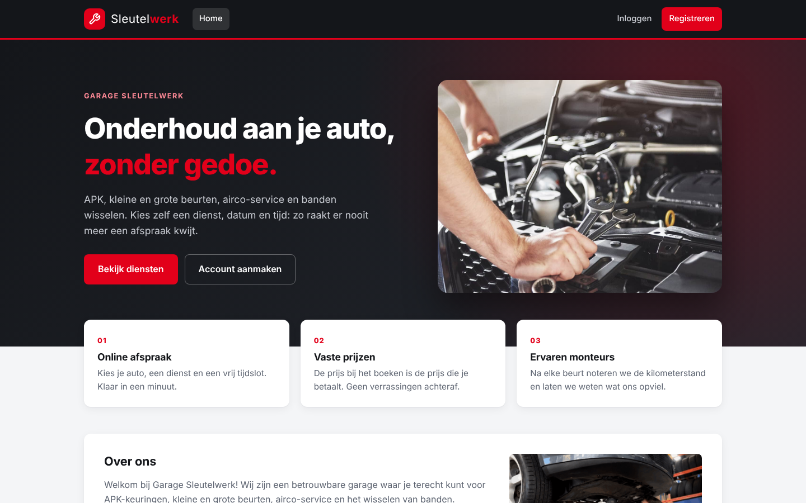
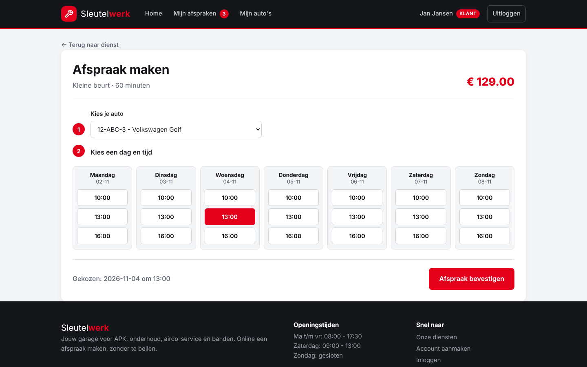
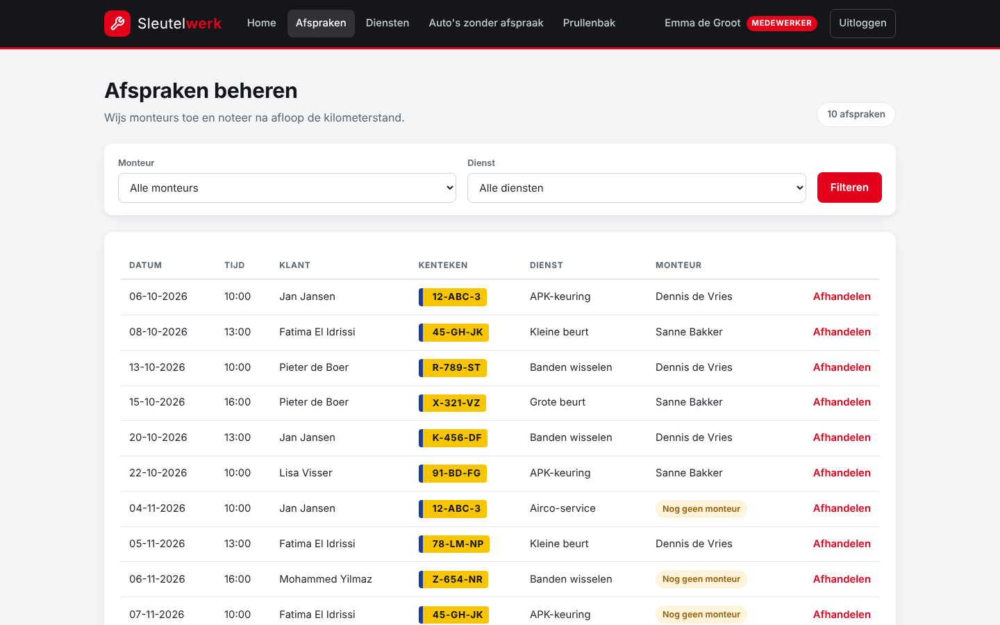
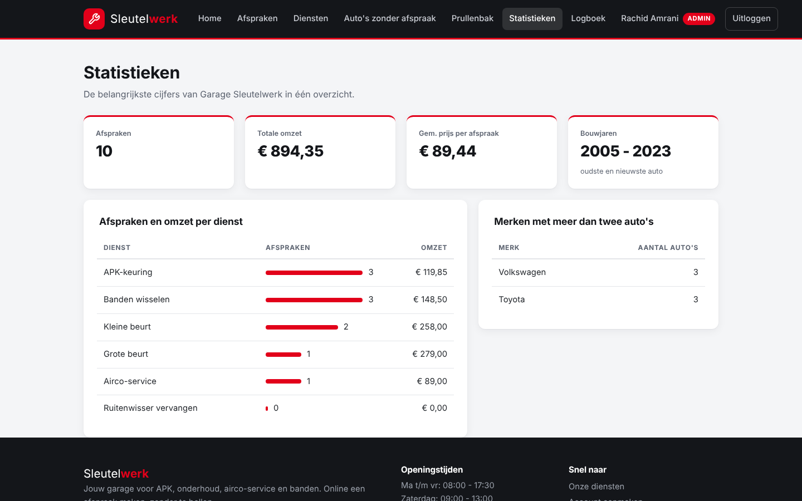

# Garage Sleutelwerk

Een webapplicatie voor **garage Sleutelwerk**. Klanten maken online een account aan, voegen hun auto's toe en plannen zelf een afspraak voor APK, onderhoud, airco-service of banden wisselen. Medewerkers beheren in een beheeromgeving de afspraken en diensten, en de eigenaar ziet statistieken en een logboek van alle wijzigingen.

Gebouwd met PHP, MySQL (MariaDB) en PDO, zonder framework, en volledig te starten met Docker.



## Inloggegevens (testaccounts)

Na het starten (zie [Starten](#starten)) kun je met deze accounts inloggen op http://localhost/login.php:

| Rol | E-mailadres | Wachtwoord |
|---|---|---|
| Klant | `klant@sleutelwerk.nl` | `Klant123!` |
| Medewerker | `medewerker@sleutelwerk.nl` | `Medewerker123!` |
| Admin | `admin@sleutelwerk.nl` | `Admin123!` |

## Functies

**Bezoeker**
- Diensten bekijken met prijs, duur en hoe vaak ze geboekt zijn
- Filteren op duur en prijs, sorteren op prijs of duur
- Account aanmaken (met controle op een bestaand e-mailadres)

**Klant**
- Inloggen met rollen (klant, medewerker, admin)
- Eigen auto's toevoegen en bewerken (kenteken moet uniek zijn)
- Afspraak maken: auto, dag en tijdslot kiezen in een weekrooster, opgeslagen via AJAX zonder dat de pagina herlaadt
- Overzicht van de eigen afspraken, met een teller in de navigatie
- Profiel bekijken en wijzigen

**Medewerker**
- Afspraken filteren op monteur en dienst
- Monteur toewijzen en na afloop kilometerstand en opmerking noteren
- Diensten toevoegen, bewerken en uitzetten (soft delete), met een prullenbak om ze terug te zetten of definitief te verwijderen
- Lijst van auto's die nog nooit een afspraak hebben gehad

**Admin**
- Alles wat een medewerker kan
- Statistieken: aantal afspraken en omzet per dienst, gemiddelde prijs per afspraak, oudste en nieuwste bouwjaar, merken met meer dan twee auto's
- Logboek: welke medewerker wat heeft aangepast

## Screenshots

| Afspraak maken (klant) | Afspraken beheren (medewerker) |
|---|---|
|  |  |



## Gebruikte technieken

| Onderdeel | Techniek |
|---|---|
| Backend | PHP 8 (zonder framework) |
| Database | MySQL / MariaDB 10.11 met PDO en prepared statements |
| Frontend | HTML, CSS (responsive, zonder framework), JavaScript (fetch / AJAX) |
| Omgeving | Docker en Docker Compose (Apache, MariaDB, phpMyAdmin) |

**Beveiliging**
- Wachtwoorden gehasht met `password_hash()` en gecontroleerd met `password_verify()`
- Alle queries met prepared statements (tegen SQL-injectie)
- Alle uitvoer via `htmlspecialchars()` (tegen XSS)
- CSRF-token op elk formulier en op de AJAX-aanvraag
- Verwijderen en terugzetten alleen via POST, nooit via een link
- Rolcontrole op elke pagina met één gedeelde functie: `vereisRol('admin', 'medewerker')`
- `session_regenerate_id()` na het inloggen
- Databasegegevens in `.env`, niet in de code

**SQL**
`JOIN` en `LEFT JOIN`, `GROUP BY` en `HAVING`, kolomfuncties (`COUNT`, `SUM`, `AVG`, `MIN`, `MAX`), `DISTINCT`, soft delete met `deleted_at` en een transactie bij definitief verwijderen. Alle queries met uitleg staan in [`SQL/queries.sql`](SQL/queries.sql).

## Starten

Je hebt alleen [Docker Desktop](https://www.docker.com/products/docker-desktop/) nodig.

```bash
git clone https://github.com/markobranytskyii/garage-sleutelwerk.git
cd garage-sleutelwerk
cp .env.example .env
docker compose up
```

Bij de eerste start maakt MariaDB automatisch alle tabellen en testdata aan (uit [`SQL/init.sql`](SQL/init.sql)), inclusief de [testaccounts](#inloggegevens-testaccounts).

| Applicatie | Adres |
|---|---|
| Webapp | http://localhost |
| phpMyAdmin | http://localhost:8000 |

Wil je de database opnieuw vullen met de testdata? Gebruik `docker compose down -v` en daarna weer `docker compose up`.

## Projectstructuur

```
garage-sleutelwerk/
├── .docker/            Dockerfile en phpMyAdmin-config
├── SQL/
│   ├── init.sql        tabellen en testdata (wordt automatisch geladen)
│   └── queries.sql     alle queries met uitleg
├── scripts/
│   └── hashing.php     eenmalig script, staat bewust buiten de website
├── screenshots/
├── www/                de website
│   ├── auth.php        sessie, vereisLogin(), vereisRol() en CSRF-functies
│   ├── database.php    PDO-verbinding (gegevens uit .env) en logWijziging()
│   ├── meldingen.php   alle meldingen op één plek
│   ├── header.php, nav.php, footer.php
│   ├── *_process.php   verwerken van formulieren (alleen POST)
│   └── style.css
├── .env.example
└── docker-compose.yaml
```

## Over dit project

Ik heb deze applicatie gebouwd in één week als eindproject voor school (projectweek 5B). Daarna heb ik de code opgeschoond en verbeterd: gedeelde login- en rolcontrole, CSRF-bescherming, verwijderen via POST, betere foutmeldingen en een nieuwe vormgeving.
